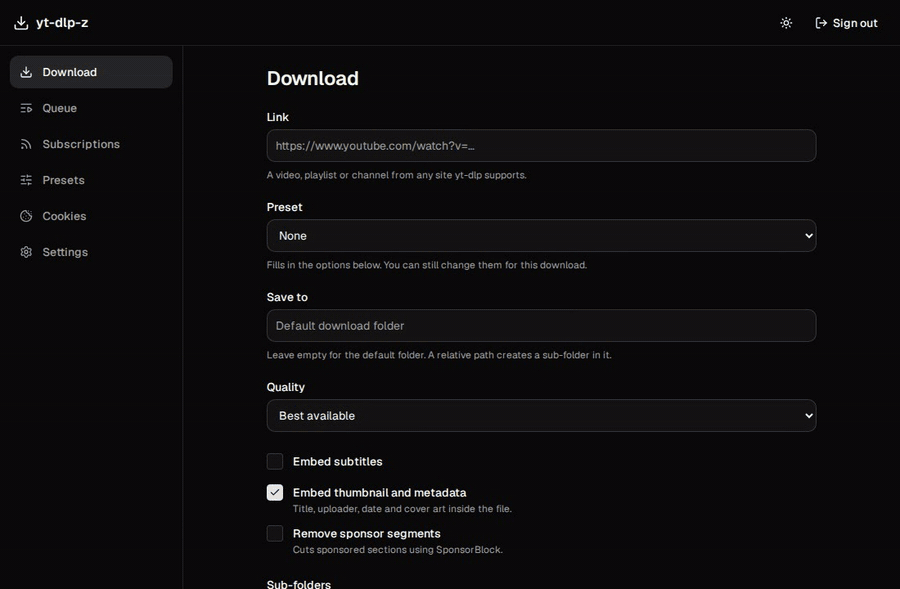
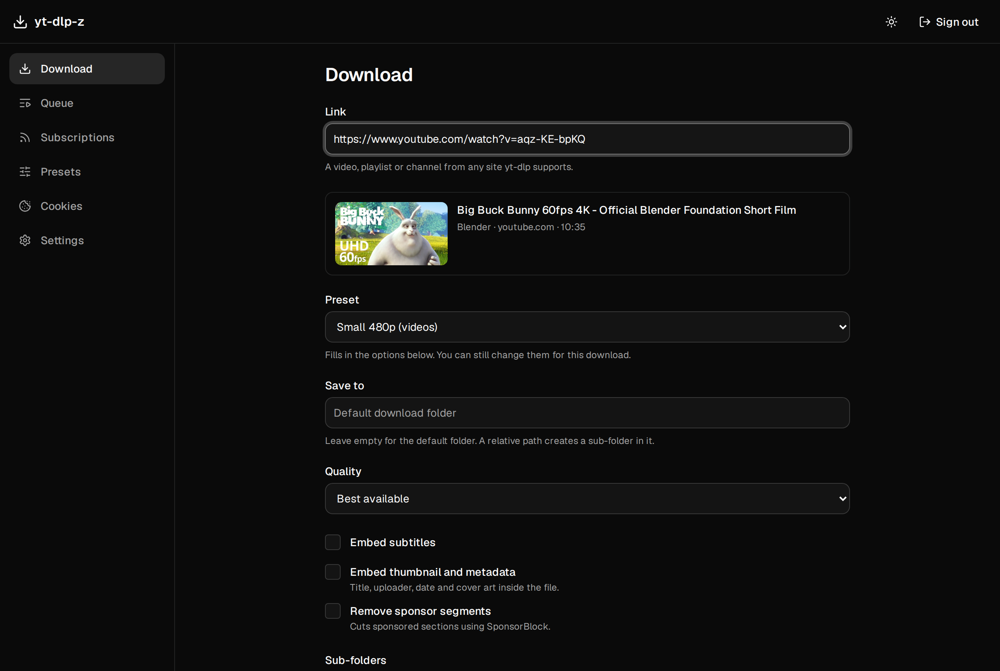
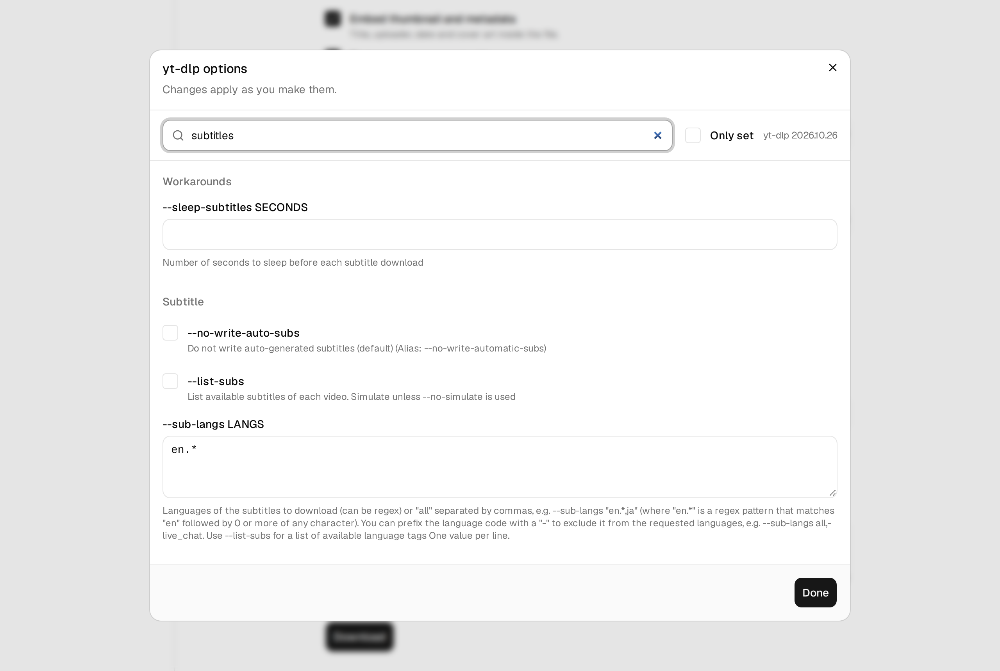
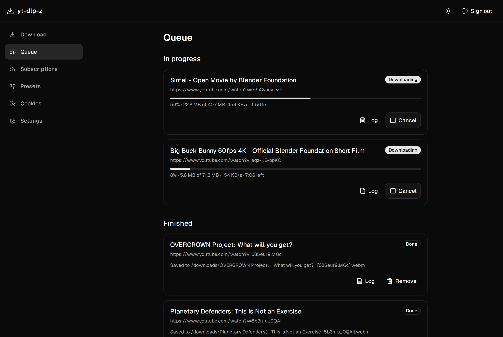
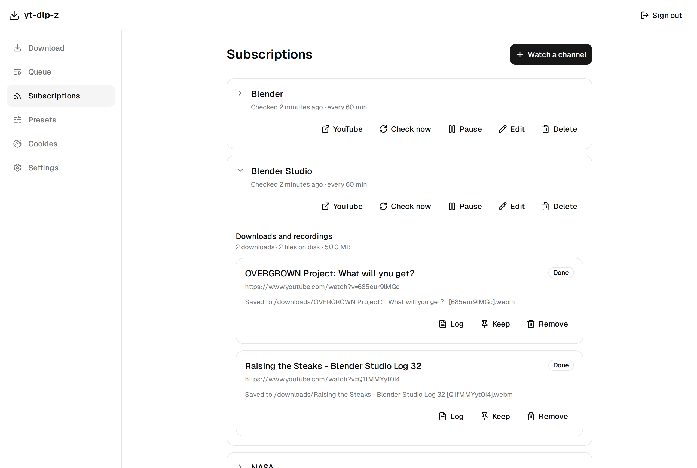
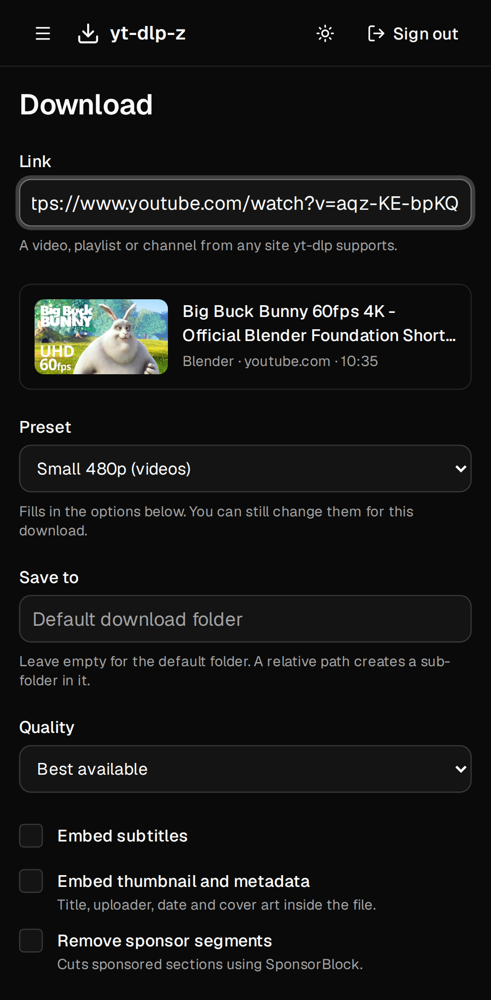
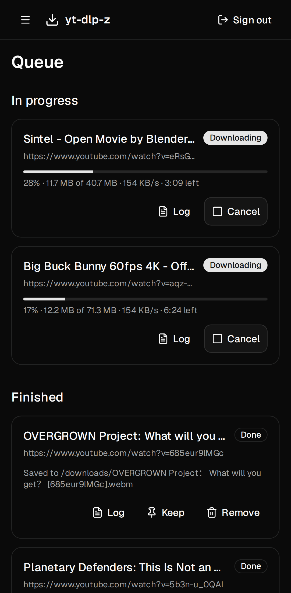
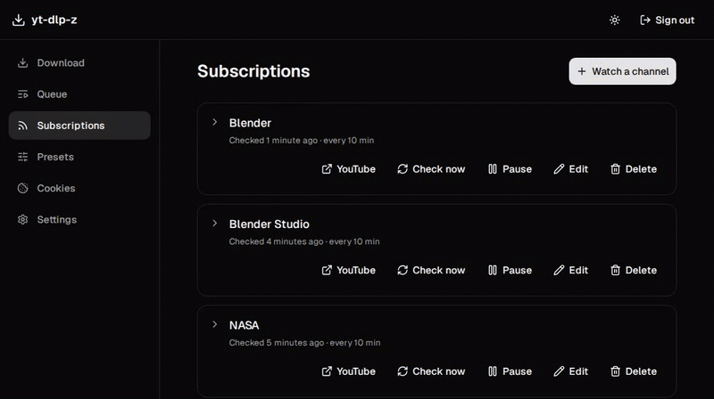

<div align="center">


# yt-dlp-z

**A self-hosted web dashboard for [yt-dlp](https://github.com/yt-dlp/yt-dlp).**<br />
Download from any site yt-dlp supports with every option it has, watch YouTube
channels and playlists, and record live streams from the very first second.

[](https://github.com/ZXY101/yt-dlp-z/actions/workflows/checks.yml)
[](https://github.com/ZXY101/yt-dlp-z/releases)
[](LICENSE)
[](backend/pyproject.toml)
[](frontend/package.json)
[](docker-compose.yml)
[](https://www.conventionalcommits.org/)

[Features](#features) ·
[Screenshots](#screenshots) ·
[Quick start](#quick-start) ·
[Documentation](docs/README.md) ·
[Similar projects](#similar-projects) ·
[Contributing](CONTRIBUTING.md)

<br />



</div>

---

## What is this?

yt-dlp is the best downloader there is, but it lives on the command line. yt-dlp-z
puts a web app in front of it that you run on your own server, NAS or PC:

- Paste a link from your phone, pick a preset, and it downloads on the server.
- Point it at a YouTube channel and new uploads show up in your library on their own.
- When that channel goes live, the stream is recorded from the start, split into
  parts if it runs for days, and optionally replaced by the clean VOD later.
- Ask an AI agent to do any of it: the built-in [MCP server](docs/mcp.md) lets agents
  such as Claude Code start downloads and change settings.

Nothing is hidden behind a simplified UI: every yt-dlp option is available,
read straight from the installed yt-dlp, so new options appear as soon as yt-dlp
adds them.

> [!NOTE]
> yt-dlp-z is young (0.x). Downloads, presets, cookies, channel watching, live
> recording and the operations features all work and are used daily, but
> settings and the API may still change between releases. See the
> [changelog](CHANGELOG.md).

## Features

### Downloads

- **Any site yt-dlp supports**: videos, playlists, channels, live streams.
- **Every yt-dlp option**, grouped and searchable, with yt-dlp's own help text.
  A short form covers the common ones (quality, file names, subtitles,
  thumbnails, metadata, SponsorBlock); an "extra options" box takes raw flags.
- **Link check**: pasting a link shows what it is (video, playlist, channel, live
  or upcoming stream) before you download, and picks the matching preset.
- **Playlist-aware**: a `watch?v=…&list=…` link asks whether you want the video
  or the whole playlist, so nothing downloads hundreds of files by accident.
- **Queue with live progress** over a WebSocket, separate limits for downloads
  and recordings, cancel, retry, per-job logs, and remove with or without files.
- **Save to any folder** inside the allowed roots, with folder suggestions.

### Presets

- Named, reusable option sets for **any link, videos, playlists or live streams**,
  with a default per kind.
- Live-stream presets carry the **recording settings** (see below).
- Per-preset **cookies**, **proxy mode**, **folder and file-name layout**.

### Channel and playlist watching (YouTube)

- Subscribe to a channel (URL or `@handle`) or a playlist.
- Filters: videos / Shorts / streams, "title must match" and "skip titles
  matching" (regex), longest duration, only uploads after a date, members-only.
- **Download recent uploads now** when you subscribe, then only new ones.
- Per-video history with **Don't download** / **Allow again**, disk usage per
  subscription, and optional **delete after N days** with a **Keep** pin.
- Falls back to the channel page when YouTube's RSS feeds are down.

### Live-stream recording

- Records live and **scheduled** streams and premieres **from the beginning**,
  even when the stream is found late.
- 24/7 streams: **a new file every N hours**, **stop after N hours**, and a
  choice between recording from now or the first N hours when a stream has
  already been live for a long time.
- Survives restarts (interrupted recordings start again) and YouTube's expiring
  stream links (the recording carries on as the next part).
- Optional **VOD after the stream**: downloads YouTube's processed copy some
  hours later, and can replace the recording with it.

### Operations

- **In-app yt-dlp updates** (stable or nightly, optional daily auto-update),
  without rebuilding the container.
- **PO tokens** through the [bgutil provider](https://github.com/Brainicism/bgutil-ytdlp-pot-provider),
  with the matching yt-dlp plugin installed and kept in step by the app.
- **Proxy pool**: HTTP/SOCKS proxies, rotate / random / sticky per channel,
  automatic cooldown on bot checks and HTTP 429, never falls back to a direct
  connection.
- **Cookies** for members-only, private and age-restricted videos, with a test button.
- **[ntfy](https://ntfy.sh) notifications** for recordings and problems.
- **Folder and file-name layout**: a folder per channel (optionally `Season 2026/`),
  names like `[20261103] Title` or `Channel - S2026E1103 - Title`, dated by the day a
  stream aired.
- **Live chat** from recordings and finished streams, saved as JSON and shown as a scrolling Niconico-style
  overlay that players pick up as a subtitle and can switch off.
- **Media-server files** for Jellyfin, Plex and Kodi: episode and show `.nfo` files,
  thumbnails, channel poster, fanart and banner.
- **Single admin password** (argon2, rate-limited sign-in), or hand login to
  your reverse proxy.
- **One container** with two volumes, or run it directly with Python and Node.
- Phone-friendly UI with light and dark themes. It follows your system until you pick one with
  the button in the header.

## Screenshots

<table>
  <tr>
    <td width="50%" valign="top">
      <b>Download with a link preview</b><br />
      
    </td>
    <td width="50%" valign="top">
      <b>Every yt-dlp option, searchable</b><br />
      
    </td>
  </tr>
  <tr>
    <td valign="top">
      <b>Queue with live progress</b><br />
      
    </td>
    <td valign="top">
      <b>Subscriptions and their downloads</b><br />
      
    </td>
  </tr>
  <tr>
    <td align="center" valign="top">
      <b>Download on a phone</b><br />
      
    </td>
    <td align="center" valign="top">
      <b>Queue on a phone</b><br />
      
    </td>
  </tr>
  <tr>
    <td colspan="2" align="center">
      <b>Light and dark themes</b><br />
      
    </td>
  </tr>
</table>

<sub>Screenshots show public-domain NASA and Creative Commons Blender videos.</sub>

## Quick start

### Docker Compose (recommended)

```sh
mkdir yt-dlp-z && cd yt-dlp-z
curl -O https://raw.githubusercontent.com/ZXY101/yt-dlp-z/main/docker-compose.yml
docker compose up -d
```

Open <http://localhost:9742> and finish the first-run setup: choose the admin
password and the default download folder.

> [!IMPORTANT]
> The first visitor chooses the admin password. If other people can reach the
> server, set `YTDLPZ_ADMIN_PASSWORD` in `docker-compose.yml` before the first
> start.

Files land in `./downloads` and settings in `./config`. Set `PUID`/`PGID` to the
user that should own them. The compose file:

```yaml
services:
  yt-dlp-z:
    image: ghcr.io/zxy101/yt-dlp-z:latest
    container_name: yt-dlp-z
    ports:
      - "9742:9742"
    environment:
      PUID: 1000
      PGID: 1000
      TZ: Etc/UTC
      # YTDLPZ_ADMIN_PASSWORD: change-me
    volumes:
      - ./config:/config
      - ./downloads:/downloads
    restart: unless-stopped
    stop_grace_period: 10m # lets running recordings finish their files
```

Images for amd64 and arm64 are on
[GHCR](https://github.com/ZXY101/yt-dlp-z/pkgs/container/yt-dlp-z): `latest`,
or pin a version such as `0.1` or `0.1.1`. To build from source instead, clone
the repository and run `docker compose up -d --build`.

### Without Docker

Needs [Node](https://nodejs.org) (version in [`.nvmrc`](.nvmrc)),
[uv](https://docs.astral.sh/uv/), [FFmpeg](https://ffmpeg.org) and
[Deno](https://deno.com) (yt-dlp uses Deno to solve YouTube's JavaScript challenges).

```sh
git clone https://github.com/ZXY101/yt-dlp-z.git && cd yt-dlp-z
npm install && npm run build -w frontend
cd backend && uv run yt-dlp-z
```

Then open <http://127.0.0.1:9742>. See [Installation](docs/installation.md) for
reverse proxies, updating, backups and running it as a service.

## Documentation

| Guide                                            | What's in it                                                       |
| ------------------------------------------------ | ------------------------------------------------------------------ |
| [Installation](docs/installation.md)             | Docker, without Docker, first run, reverse proxy, updates, backups |
| [Downloads](docs/downloads.md)                   | The download form, link check, playlists, options, the queue       |
| [Presets](docs/presets.md)                       | Kinds of presets, defaults, common options, per-preset settings    |
| [Subscriptions](docs/subscriptions.md)           | Watching channels and playlists, filters, history, retention       |
| [Live recording](docs/live-recording.md)         | Scheduled streams, parts, 24/7 streams, restarts, VODs             |
| [Cookies](docs/cookies.md)                       | Members-only and age-restricted videos, exporting cookies safely   |
| [Live chat](docs/live-chat.md)                   | Saving a stream's chat, the scrolling overlay and its look         |
| [Media servers](docs/media-server.md)            | Jellyfin / Plex / Kodi layout, `.nfo` files, artwork               |
| [Proxies](docs/proxies.md)                       | The proxy pool, rotation modes, cooldowns, a gluetun recipe        |
| [Notifications](docs/notifications.md)           | ntfy setup and events                                              |
| [API tokens and MCP](docs/mcp.md)                | Let scripts and AI agents use yt-dlp-z                             |
| [yt-dlp and PO tokens](docs/ytdlp.md)            | In-app updates, nightly builds, PO tokens, blocked options         |
| [Configuration reference](docs/configuration.md) | Environment variables, command line, volumes, security notes       |
| [Troubleshooting](docs/troubleshooting.md)       | Bot checks, 403 errors, members-only videos, recordings, FAQ       |
| [Development](docs/development.md)               | Local setup, tests, conventions                                    |

## How it works

```
Browser ──HTTP / WebSocket──▶ FastAPI (one process)
                               ├─ REST API + the built React app
                               ├─ Watcher ── RSS feeds / yt-dlp ──▶ YouTube
                               ├─ Live scheduler (waits for scheduled streams)
                               ├─ Job queue ── one yt-dlp subprocess per job ──▶ /downloads
                               ├─ Notifier ──▶ ntfy
                               └─ SQLite (/config/yt-dlp-z.db)
```

yt-dlp always runs as a separate process with an argument list (never a shell),
so a stuck download can be cancelled cleanly and yt-dlp can be updated while
the app runs. The options editor is generated from yt-dlp's own option parser.

## Similar projects

yt-dlp-z exists because none of these combined every yt-dlp option, channel
watching and live recording from the start in one place. They're all good at
what they focus on; pick the one that fits you.

| Project                                                                | Focus                                                                       |
| ---------------------------------------------------------------------- | --------------------------------------------------------------------------- |
| [yt-dlp](https://github.com/yt-dlp/yt-dlp)                             | The downloader yt-dlp-z runs. Use it directly if the command line suits you |
| [MeTube](https://github.com/alexta69/metube)                           | Simple web UI for one-off yt-dlp downloads                                  |
| [Pinchflat](https://github.com/kieraneglin/pinchflat)                  | YouTube channel and playlist downloader for media servers                   |
| [Tube Archivist](https://github.com/tubearchivist/tubearchivist)       | Full YouTube archive with its own player, search and metadata               |
| [ytdl-sub](https://github.com/jmbannon/ytdl-sub)                       | Config-file driven subscriptions for Jellyfin, Plex and Kodi                |
| [TubeSync](https://github.com/meeb/tubesync)                           | Channel and playlist sync for media servers                                 |
| [YoutubeDL-Material](https://github.com/Tzahi12345/YoutubeDL-Material) | Web UI with subscriptions and a built-in player                             |
| [yt-dlp-web-ui](https://github.com/marcopiovanello/yt-dlp-web-ui)      | Lightweight web UI for yt-dlp                                               |
| [hoshinova](https://github.com/HoloArchivists/hoshinova)               | Watches channels and records live streams with ytarchive                    |
| [ytarchive](https://github.com/Kethsar/ytarchive)                      | Command-line YouTube live-stream recorder                                   |

## Contributing

Bug reports, ideas and pull requests are welcome. Read
[CONTRIBUTING.md](CONTRIBUTING.md) and the [development guide](docs/development.md)
first. Found a security problem? See [SECURITY.md](SECURITY.md).

## Acknowledgements

- [yt-dlp](https://github.com/yt-dlp/yt-dlp) and its contributors, who do the hard part.
- [FFmpeg](https://ffmpeg.org), [Deno](https://deno.com) and the
  [bgutil PO-token provider](https://github.com/Brainicism/bgutil-ytdlp-pot-provider).
- [FastAPI](https://fastapi.tiangolo.com), [React](https://react.dev),
  [shadcn/ui](https://ui.shadcn.com), [TanStack Query](https://tanstack.com/query) and
  [ntfy](https://ntfy.sh).

## Disclaimer

yt-dlp-z is a tool. Only download content you have the right to download, and
respect the terms of the sites you use. It isn't affiliated with YouTube,
Google or the yt-dlp project.

## License

[The Unlicense](LICENSE): public domain, the same as yt-dlp.
