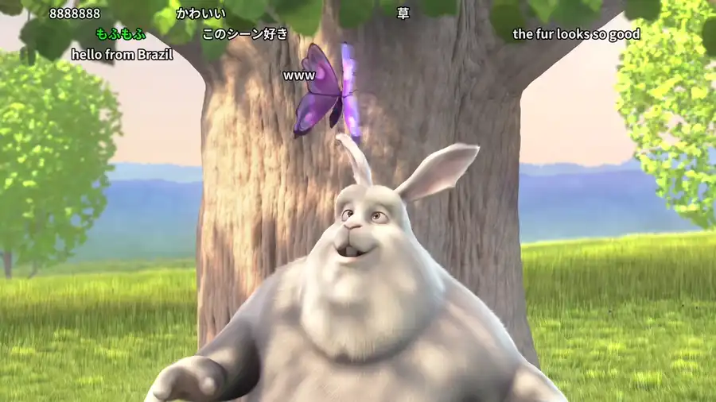

# Live chat

yt-dlp-z can save a stream's chat, while recording it or from a finished stream's replay, and turn
it into Niconico-style comments that scroll across the video. The overlay is an ordinary subtitle file, so you can turn
it off in your player like any other subtitle.

<a href="https://peach.blender.org/">Big Buck Bunny</a> (© Blender Foundation, CC BY 3.0) with a sample chat written for this demo.

Choose **Live chat** on the download form or in a [preset](presets.md):

| Choice                                | What you get next to the video                   |
| ------------------------------------- | ------------------------------------------------ |
| **Off**                               | Nothing                                          |
| **Save the chat**                     | `Title [id].live_chat.json`                      |
| **Save the chat and make an overlay** | `Title [id].live_chat.json` and `Title [id].ass` |

For a finished stream, the chat is fetched after the video is saved, and the queue shows **Fetching
its live chat** meanwhile. An 80-minute stream took two to five minutes in testing, and a long one can hold its
download slot for much longer. If the chat fails, or you cancel while it's being fetched, the video
is kept and the download still counts as done.

The files are removed together with the video when you delete it.

## What's covered

- **Finished streams and premieres** with a chat replay on YouTube. The chat is fetched after the
  video.
- **Live recordings**: the chat is saved alongside the recording while it runs. A recording split
  into parts gets one `.live_chat.json` and one `.ass` per part, each timed to its own video.
- **VODs of recordings** use the live preset's setting, and fetch the replay like any finished
  stream.
- Videos that were never a stream are skipped without asking YouTube for a chat.

Two limits apply to a recording's own capture, and a VOD has neither:

- **It starts when the recording starts.** Apart from a short backlog YouTube sends at the start,
  chat from before that isn't available, even if the video is recorded from the stream's start.
- **It follows YouTube's default chat view**, the filtered Top chat, so it holds fewer comments than
  a replay. The replay yt-dlp fetches for finished streams and VODs is unfiltered.

For the fullest chat, turn on the VOD in the live preset as well. The files appear when the recording
ends; until then the chat is kept in the config folder, under `live-chat/`.

## Changing the look later

The overlay can be rebuilt whenever you like, because the JSON is kept. In the queue, press **Chat
overlay** on the download, change the look, and press **Rebuild overlay**. The video isn't touched.
This also makes an overlay for a download that only saved the chat. A player that already has the
video open may need reopening to show the new overlay.

## The look

Under **Overlay look**:

| Setting                 | Default | Notes                                                          |
| ----------------------- | ------- | -------------------------------------------------------------- |
| Comment colours         | White   | Random, per viewer, owner and moderators, or those and members |
| Most comments on screen | 30      | The main setting for smoothness; lower it if a phone struggles |
| Time on screen          | 7 s     | How long a comment takes to cross the picture                  |
| Text size               | 48      | On a 1080p picture; the overlay scales with the video          |
| Opacity                 | 85%     |                                                                |
| Screen area             | 75%     | How much of the picture comments may use, from the top         |
| Timing offset           | 0 s     | Added to every comment; negative shows chat earlier            |
| Big and small comments  | 0%      | Share of comments shown larger or smaller                      |
| Still comments          | 0%      | Share held at the top or bottom instead of scrolling           |
| Show Super Chats        | On      | In their YouTube colour with the amount, never skipped         |

When more comments arrive than fit, some are skipped, except Super Chats and Super Stickers.
Rebuilding with the same settings gives the same result, including the random colours. Custom
emoji are images and colour emoji can't be drawn in subtitles, so they're left out; symbols such
as ★ and ♪ stay.

## Fonts

Jellyfin's web and mobile players have no system fonts, so Japanese text would show as boxes. The
overlay therefore carries its own font, cut down to the characters that chat uses (about 200 KB).
No media-server setup is needed.

The Docker image includes Noto Sans CJK. Without Docker, yt-dlp-z looks for the same font where
Linux distributions install it (`fonts-noto-cjk` on Debian and Ubuntu). To use another one, set
`YTDLPZ_CHAT_FONT` to a `.ttf`, `.otf` or `.ttc` file. With no font found, the overlay is still
made, but relies on the player's own fonts.

## Players

The overlay was tested with Jellyfin's web and mobile players and Jellyfin MPV Shim. A busy
stream asks more of a phone or browser than ordinary subtitles do; if it stutters, lower **Most
comments on screen** and rebuild.
